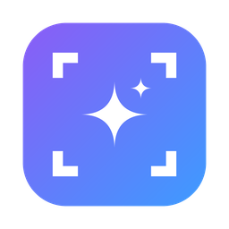

<p align="center">
  
</p>

<h1 align="center">Shotvera</h1>

<p align="center">
  <b>Capture, annotate, and ask AI about anything on your screen.</b>
</p>

<p align="center">
  
  
  
  
</p>

Shotvera is a fast screenshot tool for macOS, Windows and Linux.

1. Press the shortcut, then drag a region or click a window to snap to it.
2. Mark it up with arrows, boxes, text, numbered steps, blur and more.
3. Copy it, save it, or pin it on top of your other windows.

When a picture isn't enough, open the built-in AI assistant, powered by Claude. It can:

- explain what's on screen;
- extract or translate text;
- find the bug in an error dialog;
- black out sensitive details;
- draw annotations for you.

Annotations the AI draws are ordinary shapes, so you can edit or undo them like your own.

Shotvera is a small native app built with Tauri 2: a Rust core with a React interface. It has no account, no telemetry and no cloud storage. Your captures stay on your machine unless you ask the AI about them.

## Features

**Region and window capture**
- Snap to a window as you hover over it, or drag any region.
- A region can span several monitors.
- A pixel magnifier shows the coordinates and HEX color under the cursor. Press `C` to copy the color.
- Adjust the region with its 8 resize handles, by dragging it, or with the arrow keys (1 px, or 10 px with Shift).

**Annotation editor**
- Shapes: rectangle and ellipse (outline or filled), line, arrow, pen, highlighter.
- Text, with or without a background.
- Mosaic: brush over an area, or pixelate a whole box.
- Numbered step badges and emoji stickers.
- Select, move, resize and restyle any shape. Hold Shift to draw squares and circles, or to snap lines to 45°.
- Undo and redo.

**AI assistant (Claude)**
- Chat about your capture.
- One-click actions: *Explain*, *Extract text*, *Translate*, *Summarize*, *Redact sensitive info*, *Highlight key points*, *Find bugs*.
- The assistant adds and removes annotations itself (through tool use). You can still edit or undo its changes.
- *Capture & ask AI* and *Extract text* start a capture and open the assistant as soon as you pick a region.
- Choose your model: Claude Opus 5.5 (default), Sonnet 5.5 or Haiku 5.5.

**Output**
- Copy to the clipboard.
- Quick-save to a folder, or use *Save as…* to choose PNG or JPEG.
- Pin a capture as a floating, always-on-top window. Scroll to zoom, double-click to close.

**Menu bar and tray**
- A one-click popover offers capture, *Capture & ask AI*, *Extract text* and your recent captures.
- Click a recent capture to pin it. Hover over it to copy or delete it.
- Settings: global shortcut, launch at login, save folder, image format.

## Getting started

You need [Node.js](https://nodejs.org) 20+ and [Rust](https://rustup.rs) 1.80+. On Linux, also install the [Tauri system dependencies](https://tauri.app/start/prerequisites/).

```bash
npm install
npm run tauri dev     # run the desktop app (Rust + webview)
npm run tauri build   # build an installer for the current platform
npm run dev           # browser-only UI with a simulated two-monitor desktop (no Rust needed)
```

In browser mode, open <http://localhost:1420/#overlay?monitor=0> to try the capture editor.

**First run**

- **macOS:** grant *Screen Recording* in System Settings → Privacy & Security, then restart Shotvera.
- **AI features:** paste your [Anthropic API key](https://console.anthropic.com/) into the AI panel or Settings → AI. The key is stored in your OS credential store: Keychain, Credential Manager or Secret Service.

You can also start a capture from the command line. If Shotvera is already running, the command goes to the running instance:

```bash
shotvera --capture        # capture
shotvera --capture=ai     # capture, then open the AI assistant
shotvera --capture=ocr    # capture, then extract text
```

## Keyboard shortcuts

| Action | macOS | Windows / Linux |
|---|---|---|
| Start a capture (global, configurable) | `⌘ ⇧ 2` | `Ctrl Shift 2` |
| Copy and finish | `⌘ C`, `⌘ ↵` or double-click | `Ctrl C`, `Ctrl Enter` or double-click |
| Quick save / Save as… | `⌘ S` / `⇧ ⌘ S` | `Ctrl S` / `Ctrl Shift S` |
| Pin to screen | `F3` | `F3` |
| Toggle the AI assistant | `I` | `I` |
| Undo / Redo | `⌘ Z` / `⇧ ⌘ Z` | `Ctrl Z` / `Ctrl Y` |
| Select, Rectangle, Ellipse, Line, Arrow | `V` `R` `O` `L` `A` | same |
| Pen, Highlighter, Text, Mosaic, Step, Emoji | `P` `H` `T` `M` `N` `E` | same |
| Copy the color under the cursor (while selecting) | `C` | `C` |
| Move the region 1 px / 10 px | arrow keys / with `⇧` | arrow keys / with `Shift` |
| Delete the selected annotation | `⌫` | `Delete` |
| Deselect, close the assistant, or cancel | `Esc` | `Esc` |

## Privacy

- Captures are saved only where you choose. The 60 most recent are also kept on your device for the *Recent* list.
- Shotvera connects only to `api.anthropic.com`, and only when you use an AI feature. It then sends your chat messages and the selected region, scaled down to at most 1568 px on its longest edge.
- There is no telemetry, analytics or crash reporting.

See [SECURITY.md](SECURITY.md) for the full security model and how to report a vulnerability.

## Project status

Shotvera is at **0.1**, an early release. Known limitations:

- The interface is in **Vietnamese** for now. English localization is planned.
- Shotvera is developed and tested on macOS, including multi-monitor setups. Windows and Linux builds have not been tested on real hardware yet.
- On Linux, a selection drag stays within one monitor.
- Text extraction uses the AI assistant, so it needs an API key. Offline OCR is on the roadmap.
- Release builds are not code-signed or notarized yet.

## Architecture

```
src/                     React + TypeScript (Vite)
  overlay/               capture UI: region selection, Konva annotation editor, toolbar
  ai/                    assistant panel, Claude tool use via @anthropic-ai/sdk
  home/ pin/ settings/   menu-bar popover, pinned images, settings window
  lib/platform.ts        the only bridge to Rust (with browser fallbacks for UI work)
src-tauri/               Rust (Tauri 2)
  src/capture.rs         multi-monitor capture (xcap), one overlay window per monitor, window list
  src/output.rs          clipboard, saving, pinning, capture history
  src/windows.rs         menu-bar popover and settings window
  src/platform.rs        OS-specific code: permissions, global pointer, overlay window level
  src/secrets.rs         API key in the OS credential store
scripts/gen-icons.mjs    generates the app and tray icons
scripts/release.mjs      bumps the version, tags and pushes a release
.github/workflows/       release pipeline (GitHub Actions)
```

**How a capture works**

1. Rust captures every monitor as raw RGBA.
2. It sends each frame, unencoded, to that monitor's pre-created overlay window over IPC, so the overlay appears instantly.
3. The overlays share one document (selection, annotations, current tool) in desktop coordinates. That is what lets a selection span monitors.
4. On export, the frontend merges the screen pixels and the annotation layer at native resolution.
5. The frontend sends the result back to Rust as RGBA, and Rust copies or saves it.

## Building installers

Tauri builds installers for the platform you run it on. To get every platform at once, use the release pipeline described below.

| Command | Output (in `src-tauri/target/**/release/bundle/`) |
|---|---|
| `npm run build:mac` | `.app` and `.dmg` for this Mac's architecture |
| `npm run build:mac:intel` | `.app` and `.dmg` for Intel Macs |
| `npm run build:mac:universal` | one `.dmg` that runs on Apple Silicon and Intel |
| `npm run build:win` | `-setup.exe` (NSIS) and `.msi` installers |
| `npm run build:linux` | `.AppImage`, `.deb` and `.rpm` |

Some builds need extra Rust targets first:

```bash
rustup target add x86_64-apple-darwin                       # build:mac:intel
rustup target add x86_64-apple-darwin aarch64-apple-darwin  # build:mac:universal
```

Builds are unsigned unless you configure signing:

- macOS apps are ad-hoc signed, so users must confirm the first launch in System Settings → Privacy & Security.
- On Windows, SmartScreen shows a warning until the installer is code-signed.

## Releasing

A tag push builds every platform on GitHub Actions and publishes the installers on the [Releases](https://github.com/nguyenhung10012003/shotvera/releases) page:

```bash
npm run release -- patch     # or minor, major, or an explicit version such as 1.0.0
```

The command:

1. bumps the version in `package.json`, `package-lock.json` and `src-tauri/Cargo.toml`;
2. commits the change and tags it `vX.Y.Z`;
3. pushes the commit and the tag.

The [release workflow](.github/workflows/release.yml) then takes over:

1. It creates a draft release.
2. It builds the following installers in parallel:
   - macOS: Apple Silicon and Intel `.dmg`;
   - Windows: `-setup.exe` and `.msi`;
   - Linux: `.AppImage`, `.deb` and `.rpm`.
3. It uploads the installers to the draft release.
4. Once every build succeeds, it publishes the release.

To rebuild an existing tag, run the workflow from the Actions tab.

Pre-release versions must use numeric identifiers, such as `1.0.0-1`, because the Windows MSI format rejects `-beta`.

**Signing on macOS (optional).** To sign and notarize the macOS builds, add these repository secrets:

- `APPLE_CERTIFICATE`: a base64-encoded `.p12` Developer ID certificate;
- `APPLE_CERTIFICATE_PASSWORD`;
- `APPLE_SIGNING_IDENTITY`;
- `APPLE_ID`;
- `APPLE_PASSWORD`: an app-specific password;
- `APPLE_TEAM_ID`.

Without them, builds are ad-hoc signed.

## Roadmap

- [ ] English localization
- [ ] Offline OCR (Apple Vision, Windows.Media.Ocr, Tesseract)
- [ ] Screen recording (video / GIF)
- [ ] AI image generation and editing with a configurable provider
- [ ] Scrolling capture and timed capture
- [ ] ScreenCaptureKit on macOS 14+
- [ ] Signed and notarized releases

## Contributing

Issues and pull requests are welcome. Before opening a PR, run:

```bash
npm run typecheck
cargo clippy --manifest-path src-tauri/Cargo.toml
```

Please report security issues privately, as described in [SECURITY.md](SECURITY.md).

## License

Shotvera is licensed under the [Apache License 2.0](LICENSE). Copyright 2026 The Shotvera Authors; see [NOTICE](NOTICE).

Claude is a trademark of Anthropic, PBC. Shotvera is an independent project, not affiliated with or endorsed by Anthropic.
